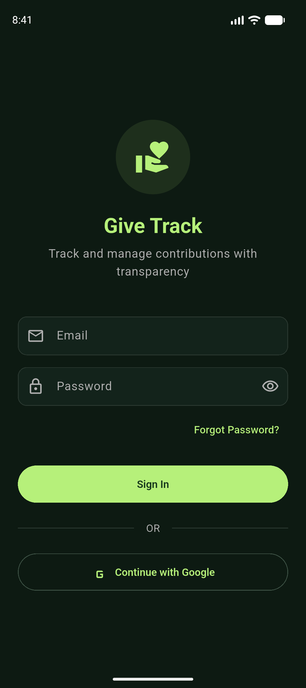

# Give Track

<p>
  
</p>

Captured on an Android emulator from the debug build. Projects, contributions, and the dashboard open after sign-in, so they are not shown here.


A real-time mobile application for tracking and managing contributions from **contributors** in community, educational, and organizational projects.

## Features

- **Real-time Contribution Tracking**: Record and monitor contributions instantly across all devices
- **Project Management**: Create, configure, and manage multiple projects with custom settings
- **Role-Based Access Control**: Leaders, sub-leaders, and viewers with hierarchical permissions
- **Dashboard & Analytics**: Visual insights with charts, progress tracking, and reports
- **Offline Support**: Queue entries for sync when reconnected (prepared for Firebase)
- **Multilingual**: Support for French and English

## Architecture

This project follows **Clean Architecture** principles with the following layers:

```
lib/
├── core/                    # Shared utilities, widgets, constants, errors
├── config/                  # App configuration (routes, theme)
├── features/
│   ├── auth/               # Authentication (login, onboarding)
│   ├── dashboard/          # Home dashboard with analytics
│   ├── projects/           # Project CRUD and management
│   ├── contributions/      # Contribution recording and contributor management
│   └── settings/           # App settings and user management
└── main.dart
```

## Tech Stack

| Package | Version | Purpose |
|---------|---------|---------|
| `flutter_riverpod` | ^3.3.1 | State management |
| `go_router` | ^17.1.0 | Navigation |
| `flutter_form_builder` | ^10.3.0 | Form handling |
| `form_builder_validators` | ^11.3.0 | Form validation |
| `form_builder_extra_fields` | ^11.0.0 | Extra form fields |
| `fl_chart` | ^1.2.0 | Charts and visualizations |
| `firebase_core` | ^4.7.0 | Firebase app bootstrap |
| `firebase_auth` | ^6.4.0 | Authentication |
| `cloud_firestore` | ^6.3.0 | User profiles (`users/{uid}`) |
| `google_sign_in` | ^7.2.0 | Google Sign-In (with Firebase) |
| `shared_preferences` | ^2.5.0 | Local storage |
| `flutter_slidable` | ^4.0.0 | Swipe actions |
| `shimmer` | ^3.0.0 | Loading skeletons |
| `equatable` | ^2.0.7 | Value equality |
| `dartz` | ^0.10.1 | Functional programming |
| `freezed_annotation` | ^2.4.4 | Immutable data classes |
| `json_annotation` | ^4.9.0 | JSON serialization |

## Getting Started

1. Ensure you have Flutter SDK >=3.7.0 installed
2. Clone the repository
3. Run `flutter pub get`
4. Complete **Firebase Setup (Backend)** below before signing in on a device or
   simulator
5. Run `flutter run`

## Firebase Setup (Backend)

The app initializes Firebase in `main.dart` and uses `FirebaseAuthRepository`
(email/password, Google) with Firestore profiles under `users/{uid}`.

1. Create a Firebase project at
   [console.firebase.google.com](https://console.firebase.google.com).
2. Enable **Authentication** (Email/Password and Google) and create a **Cloud
   Firestore** database.
3. Register an Android app with package `com.example.give_track` and an iOS app
   with bundle ID `com.example.giveTrack`.
4. Deploy Firestore rules from this repo (after `firebase login` and
   `firebase use <PROJECT_ID>`):

   ```bash
   npx -y firebase-tools@latest deploy --only firestore:rules
   ```

5. Generate and install config from the project root:

   ```bash
   dart pub global activate flutterfire_cli
   flutterfire configure -p <PROJECT_ID> --yes --platforms=android,ios,web
   ```

   This overwrites `lib/firebase_options.dart`, `android/app/google-services.json`,
   and `ios/Runner/GoogleService-Info.plist`. If `REVERSED_CLIENT_ID` changes,
   update the `CFBundleURLSchemes` entry in `ios/Runner/Info.plist` to match
   (required for Google Sign-In on iOS).

6. **Placeholder files** are committed so the project compiles before you run
   step 5; replace them with real values or sign-in will fail at runtime.

7. For tests, override providers from `lib/data/di/backend_providers.dart`
   (e.g. `authRepositoryProvider`, `projectRepositoryProvider`).

### Data layer (switch BaaS)

Domain contracts live under `features/*/domain/repositories/`. Implementations:

| Backend | Location | Notes |
|---------|----------|--------|
| Mock | `lib/data/mock/` | Default; in-memory data + `MockAuthRepository`. |
| Firebase | `lib/data/firebase/` | Firestore + existing `FirebaseAuthRepository`. |
| Appwrite | `lib/data/appwrite/` | Stubs return `Left`; implement when you add the SDK. |

Compile-time switch (defaults to `mock`):

```bash
flutter run --dart-define=BACKEND=firebase
# or: --dart-define=BACKEND=appwrite
```

`lib/data/di/backend_providers.dart` wires `backendKindProvider` to concrete repos.

When using **firebase**, deploy rules above and seed or create `projects` / `contributions` / `contributors` collections (or use the app to create them while signed in).

## Project Structure

```
give_track/
├── android/                 # Android platform code
├── ios/                     # iOS platform code
├── lib/
│   ├── main.dart           # Entry point
│   ├── app.dart            # Root widget with Riverpod scope
│   ├── config/
│   │   ├── routes.dart     # GoRouter configuration with shell routes
│   │   └── theme.dart      # Light/dark theme definitions
│   ├── core/
│   │   ├── constants/      # App constants
│   │   ├── errors/         # Failure classes
│   │   ├── utils/          # Extensions and helpers
│   │   └── widgets/        # Shared UI components
│   └── features/
│       ├── auth/           # Login, onboarding, user entity
│       ├── dashboard/      # Home screen with charts
│       ├── projects/       # Project list, detail, create
│       ├── contributions/  # Record contributions, contributor management
│       └── settings/       # App settings, invite leaders
├── pubspec.yaml
└── analysis_options.yaml
```

## Screens

| Screen | Route | Description |
|--------|-------|-------------|
| Login | `/` | Email/password + Google sign-in |
| Onboarding | `/onboarding` | First-time user walkthrough |
| Dashboard | `/dashboard` | Overview with stats and charts |
| Projects | `/projects` | List of active/archived projects |
| Project Detail | `/projects/:id` | Project details and activity |
| Create Project | `/projects/create` | New project form |
| Contributions | `/contributions` | List of all contributions |
| Record Contribution | `/contributions/record` | Log new contribution |
| Contributors | `/contributors` | Manage contributors |
| Settings | `/settings` | App preferences and account |
| Invite Leaders | `/settings/invite` | Send role-based invitations |

## License

MIT License - see LICENSE file for details.
